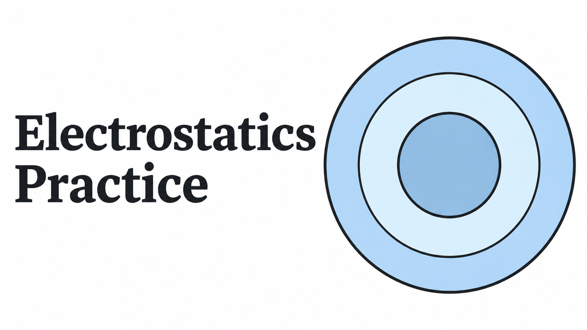
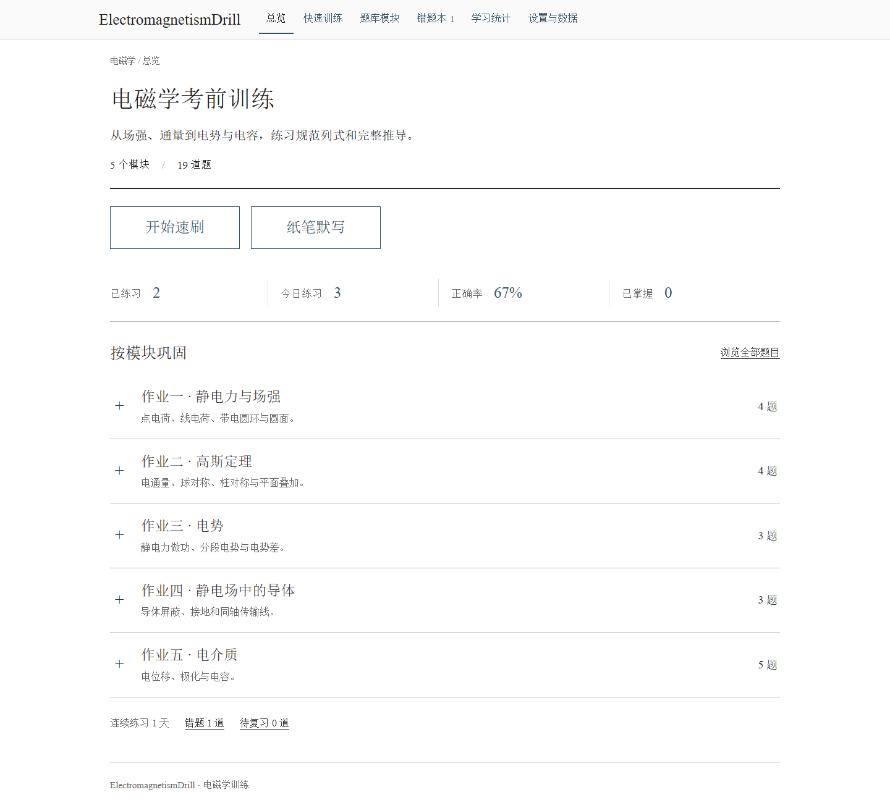
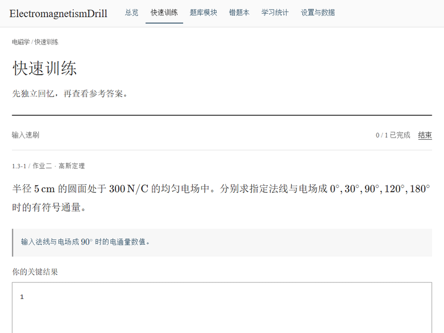
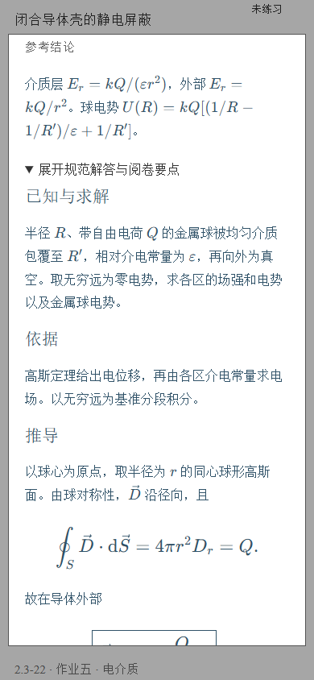
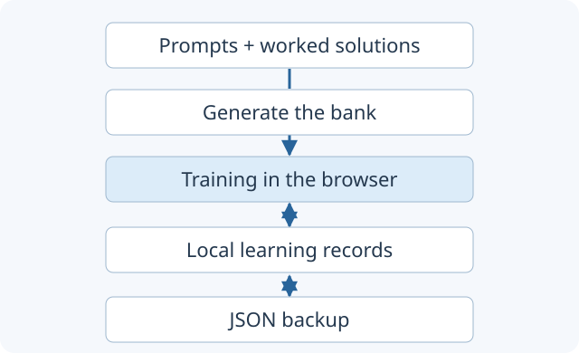

# ElectromagnetismDrill



**Practice setting up and writing complete electrostatics derivations, from fields and flux to potentials and capacitance.**

[GitHub Pages entry](https://yuxuan6426.github.io/ElectromagnetismDrill/) · [Sources and maintenance](docs/workspace.md) · [中文](README.md)

ElectromagnetismDrill combines 19 exercises from five homework sets. Find exercises by number or topic, compare your work with the derivation, and revisit mistakes in later sessions. Desktop and mobile use the same bank. The exercise interface and derivations are in Chinese.



| Set | Exercises | Topics |
| --- | ---: | --- |
| 1 | 4 | Point and line charges, charged rings and disks |
| 2 | 4 | Electric flux, Gauss's law and charged planes |
| 3 | 3 | Electrostatic work, piecewise potentials and potential differences |
| 4 | 3 | Shielding, grounding and coaxial conductors |
| 5 | 5 | Electric displacement, polarization and capacitance |

## Practice modes

- **Quick input** checks a specified key result. After submitting, compare your entry with the reference notation and correction hint.
- **Paper practice** gives you time to work through a derivation before revealing it. Use the grading points to mark the attempt as mastered, uncertain or incorrect.
- **Concept check** asks you to judge a formula, direction or assumption and explains the underlying physics.



Solutions follow five steps: givens and goal, governing principle, derivation, result and grading points. Vectors use arrows above their symbols, with components and magnitudes written as scalars. Exercises are based on Zhao Kaihua and Chen Ximou's *Electromagnetism*, fourth edition. The app uses paraphrased prompts, original diagrams and plots drawn from equations.



## Progress and backups

Drafts, attempts and review schedules are saved in your browser. Export a full JSON backup from Settings & Data before switching browsers or devices or clearing your browser data. Quick input checks the specified notation. Use the worked solution to self-assess equivalent expressions and complete derivations.

## Run locally

With Node.js 24 and npm, run these commands in the repository:

```bash
npm ci
npm run dev
```

Open the [local app](http://127.0.0.1:5173/ElectromagnetismDrill/). Use `npm run build` to build the static site and `npm run preview` to preview the build.

## Architecture and contributions



Follow the [bank maintenance guide](docs/workspace.md) after changing prompts, solutions or plotting equations. The interface and training workflow are based on [PhysDrill](https://github.com/yuxuan6426/PhysDrill) and [MechanicsDrill](https://github.com/yuxuan6426/MechanicsDrill). Code is under the [MIT License](LICENSE). See [asset notes](docs/assets/README.md).
