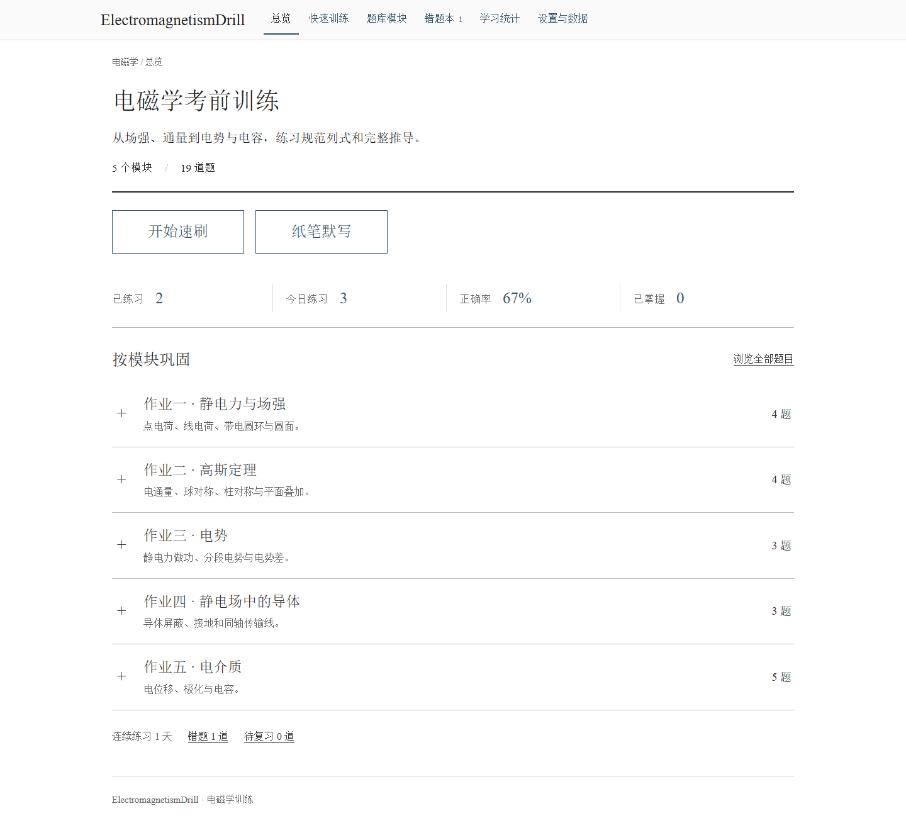
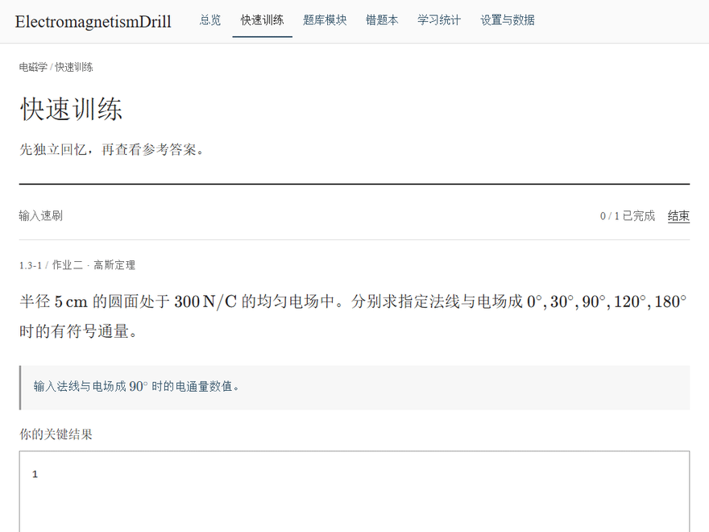
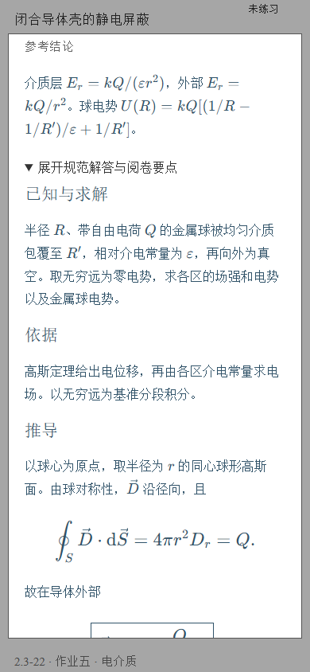
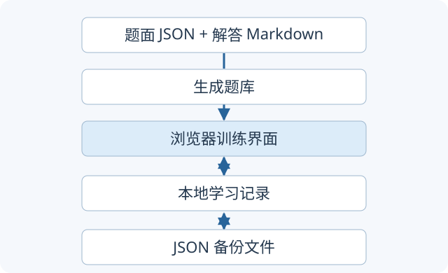

# ElectromagnetismDrill


**从场强、通量到电势与电容，练习规范列式和完整推导。**

[GitHub Pages 入口](https://yuxuan6426.github.io/ElectromagnetismDrill/) · [题源与维护](docs/workspace.md) · [English](README.en.md)

ElectromagnetismDrill 将五次电磁学作业汇成 19 道习题。按题号或知识点选题，作答后对照推导，再用错题本安排重练。桌面和手机共用同一套题库。



| 作业 | 题数 | 内容 |
| --- | ---: | --- |
| 一 | 4 | 点电荷叠加、线电荷、圆环和圆面 |
| 二 | 4 | 电通量、高斯定理和带电平面 |
| 三 | 3 | 静电力做功、分段电势和电势差 |
| 四 | 3 | 导体屏蔽、接地和同轴传输线 |
| 五 | 5 | 电位移、极化和电容 |

## 练习方式

- **输入速刷**检查题目指定的关键结果。提交后可查看参考写法和差异提示。
- **纸笔默写**先独立写出推导，再揭示解答，按阅卷要点选择掌握了、不确定或答错了。
- **易错辨析**判断公式、方向或条件，查看错误背后的物理依据。



解答依次呈现已知条件、依据、推导、结果和阅卷要点。矢量用字母上方的箭头标记，分量和量值采用标量写法。题库来源为赵凯华、陈熙谋《电磁学》（第四版），页面使用转述题面、自绘示意图和由公式绘制的曲线。



## 进度与备份

草稿、练习记录和复习安排保存在当前浏览器。换设备、换浏览器或清理数据前，从「设置与数据」导出完整 JSON 备份，再在目标浏览器导入。输入速刷的匹配范围是指定写法，等价表达式和完整推导可按解答自评。

## 本地运行

使用 Node.js 24 和 npm。在仓库目录运行：

```bash
npm ci
npm run dev
```

打开 [本地开发页](http://127.0.0.1:5173/ElectromagnetismDrill/)。`npm run build` 生成静态站点，`npm run preview` 预览构建结果。

## 架构与贡献



修改题面、解答或作图公式后，按 [题库维护说明](docs/workspace.md) 重新生成题库并测试。界面和训练流程源自 [PhysDrill](https://github.com/yuxuan6426/PhysDrill) 与 [MechanicsDrill](https://github.com/yuxuan6426/MechanicsDrill)。代码采用 [MIT 许可](LICENSE)。[素材说明](docs/assets/README.md)。
