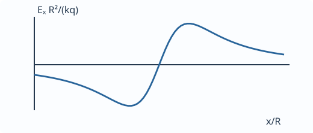

### 已知与求解

均匀带电圆环的半径为 $R$，总电荷为 $q$。求轴向有符号场强分量 $E_x(x)$，画出分布，并给出场强大小的极值位置与最大值。

### 依据

沿圆环积分库仑场。对称电荷元的横向分量相互抵消。

### 推导

**（1）求轴线上场强。**

取圆环上一电荷微元 $\mathrm dq$。微元到轴线上场点的距离恒为

$$
r=\sqrt{R^2+x^2}.
$$

微元产生的场强大小为 $\mathrm dE=k\,\mathrm dq/r^2$。由圆环对称性，垂直于轴线的分量两两抵消，只有轴向分量叠加。若 $\alpha$ 为微元场强与轴线的夹角，则 $\cos\alpha=x/r$，因此

$$
\mathrm dE_x=\mathrm dE\cos\alpha
=k\frac{x\,\mathrm dq}{(R^2+x^2)^{3/2}}.
$$

对整个圆环积分，利用 $\int\mathrm dq=q$，得

$$
E_x=k\frac{qx}{(R^2+x^2)^{3/2}}
=\frac{1}{4\pi\varepsilon_0}
\frac{qx}{(R^2+x^2)^{3/2}}.
$$

故

$$
\boxed{\vec{E}=\frac{1}{4\pi\varepsilon_0}
\frac{qx}{(R^2+x^2)^{3/2}}\vec{e}_x.}
$$

当 $q>0$ 时，$x>0$ 处场强沿 $+x$ 方向，$x<0$ 处场强沿 $-x$ 方向；若 $q<0$，方向相反。

**（2）画出 $E-x$ 曲线。**

当 $q>0$ 时，$E_x(x)$ 是奇函数：过原点，左半轴为负、右半轴为正；当 $|x|\to\infty$ 时，$E_x\to0$。曲线在 $x=-R/\sqrt2$ 处取得负极小值，在 $x=R/\sqrt2$ 处取得正极大值。下图给出无量纲曲线，其中 $u=x/R$，纵坐标为 $E_x/(kq/R^2)$。

\begin{figure}[htbp]
\centering

\caption{均匀带电圆环轴向场强曲线（$q>0$）}
\end{figure}

**（3）求场强最大值。**

对 $E_x(x)$ 求导：

$$
\frac{\mathrm dE_x}{\mathrm dx}
=kq\frac{R^2-2x^2}{(R^2+x^2)^{5/2}}.
$$

令导数为零，得到驻点

$$
x=\pm\frac{R}{\sqrt2}.
$$

其中 $x=R/\sqrt2$ 处为正向最大值，$x=-R/\sqrt2$ 处为负向最小值。最大场强的大小为

$$
E_{\max}=k\frac{|q|(R/\sqrt2)}{\left(R^2+R^2/2\right)^{3/2}}
=\frac{2k|q|}{3\sqrt3R^2}
=\frac{|q|}{6\sqrt3\pi\varepsilon_0R^2}.
$$

若按教材默认 $q>0$，正向最大值即

$$
E_{\max}=\frac{q}{6\sqrt3\pi\varepsilon_0R^2}.
$$

### 结果

$E_x=kqx/(x^2+R^2)^{3/2}$，在 $x=\pm R/\sqrt2$ 处场强大小最大，为 $\lvert q\rvert/(6\sqrt3\pi\varepsilon_0R^2)$。

### 阅卷要点

对称电荷元横向分量抵消，轴向分量叠加。最大值针对场强大小。
