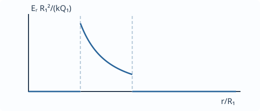

### 已知与求解

半径 $R_1<R_2$ 的同心球面分别均匀分布电荷 $Q_1,Q_2$。求三个开区间内的径向场强，并画出 $Q_1=-Q_2$ 时的 $E_r(r)$ 曲线。

### 依据

在各区取同心球形高斯面，利用球对称及包围电荷求场。

### 推导

两个球面均为均匀球面电荷分布，体系具有球对称性。因此，场强方向沿径向，且在以球心为中心、半径为 $r$ 的高斯球面上大小处处相等。令

$$
\vec{E}(r)=E_r(r)\vec{e}_r,
$$

其中 $\vec{e}_r$ 为径向单位矢量。由高斯定理

$$
\oint_S\vec{E}\cdot\mathrm d\vec{S}
=E_r(r)\,4\pi r^2
=\frac{Q_{\mathrm{in}}}{\varepsilon_0}.
$$

**（1）I 区域：$0\le r<R_1$**

高斯面内不包围任何球面电荷，故

$$
Q_{\mathrm{in}}=0,
\qquad E_r\,4\pi r^2=0.
$$

于是

$$
\boxed{\vec{E}=\vec{0},\qquad r<R_1.}
$$

**（2）II 区域：$R_1<r<R_2$**

高斯面包围内球面上的全部电荷 $Q_1$，不包围外球面电荷，故

$$
Q_{\mathrm{in}}=Q_1,
\qquad E_r\,4\pi r^2=\frac{Q_1}{\varepsilon_0}.
$$

所以

$$
\boxed{\vec{E}=\frac{Q_1}{4\pi\varepsilon_0r^2}\vec{e}_r,
\qquad R_1<r<R_2.}
$$

**（3）III 区域：$r>R_2$**

高斯面包围两个球面上的全部电荷，故

$$
Q_{\mathrm{in}}=Q_1+Q_2,
\qquad E_r\,4\pi r^2=\frac{Q_1+Q_2}{\varepsilon_0}.
$$

所以

$$
\boxed{\vec{E}=\frac{Q_1+Q_2}{4\pi\varepsilon_0r^2}\vec{e}_r,
\qquad r>R_2.}
$$

综上，三个区域的场强分布为

$$
\boxed{
\vec{E}(r)=
\begin{cases}
\vec{0}, & 0\le r<R_1,\\[4pt]
\dfrac{Q_1}{4\pi\varepsilon_0r^2}\vec{e}_r,
  & R_1<r<R_2,\\[8pt]
\dfrac{Q_1+Q_2}{4\pi\varepsilon_0r^2}\vec{e}_r,
  & r>R_2.
\end{cases}}
$$

这里的电荷量按代数值代入：正电荷对应径向向外，负电荷对应径向向内。

**（2）当 $Q_1=-Q_2$ 时**

此时总电荷量为零：

$$
Q_1+Q_2=0.
$$

因此，I 区域仍然没有包围电荷，场强为零；II 区域仍只包围内球面的电荷 $Q_1$，场强不变；III 区域包围的总电荷为零，场强也为零。即

$$
\boxed{
\vec{E}(r)=
\begin{cases}
\vec{0}, & r<R_1,\\[3pt]
\dfrac{Q_1}{4\pi\varepsilon_0r^2}\vec{e}_r,
  & R_1<r<R_2,\\[8pt]
\vec{0}, & r>R_2.
\end{cases}}
$$

其径向分量 $E_r-r$ 曲线见结果部分。图中以 $Q_1>0$ 为例；若 $Q_1<0$，中间一段关于横轴反向。

**补充说明：**理想薄球面处场强存在跃变。严格地说，$r=R_1$、$r=R_2$ 处应分别给出内、外侧极限；不把球面上的单一数值误作两侧共同的场强。

### 结果

由内到外，$E_r=0$、$kQ_1/r^2$、$k(Q_1+Q_2)/r^2$。

### 阅卷要点

逐区列出高斯面包围电荷，区分球面两侧极限。
