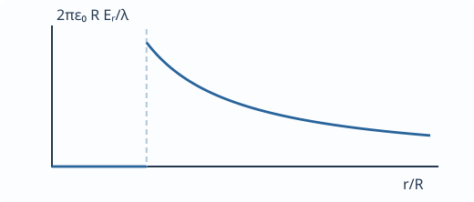

### 已知与求解

半径 $R$ 的无限长圆筒面均匀带电，单位轴长电荷为 $\lambda$。求筒内、筒外的场强，并画径向分量随 $r$ 的变化。

### 依据

用同轴圆柱高斯面，场强只有径向分量。

### 推导

无限长均匀带电圆筒面具有轴对称性和沿轴线方向的平移对称性。因此，场强只能沿垂直于轴线的径向，且在同轴、半径为 $r$、长度为 $L$ 的圆柱形高斯面侧面上大小处处相等。设

$$
\vec{E}(r)=E_r(r)\vec{e}_r.
$$

高斯面的两个端面法线沿圆筒轴线方向，而场强沿径向，所以端面通量为零；只有圆柱侧面有电通量。

**（1）圆筒面内：$r<R$**

高斯面不包围圆筒面上的电荷，故

$$
Q_{\mathrm{in}}=0,
\qquad E_r(2\pi rL)=0.
$$

因此

$$
\boxed{\vec{E}=\vec{0},\qquad r<R.}
$$

**（2）圆筒面外：$r>R$**

长度为 $L$ 的圆筒面所带电荷为

$$
Q_{\mathrm{in}}=\lambda L.
$$

由高斯定理

$$
\oint_S\vec{E}\cdot\mathrm d\vec{S}
=E_r(2\pi rL)
=\frac{\lambda L}{\varepsilon_0}.
$$

约去 $L$，得到

$$
\boxed{\vec{E}=\frac{\lambda}{2\pi\varepsilon_0r}\vec{e}_r,
\qquad r>R.}
$$

综上

$$
\boxed{
\vec{E}(r)=
\begin{cases}
\vec{0}, & r<R,\\[5pt]
\dfrac{\lambda}{2\pi\varepsilon_0r}\vec{e}_r, & r>R.
\end{cases}}
$$

当 $\lambda>0$ 时，场强沿径向向外；当 $\lambda<0$ 时，场强沿径向向内。其径向分量曲线以 $\lambda>0$ 为例：

在圆筒面处，场强的两侧极限为

$$
E_r(R^-)=0,\qquad
E_r(R^+)=\frac{\lambda}{2\pi\varepsilon_0R}.
$$

理想薄面电荷处存在跃变；若只画场强大小，则圆筒面外曲线为 $|\lambda|/(2\pi\varepsilon_0r)$。

### 结果

筒内 $E_r=0$；筒外 $E_r=\lambda/(2\pi\varepsilon_0r)$。

### 阅卷要点

用同轴圆柱高斯面，端面通量为零，注明 $R$ 处的跃变。
