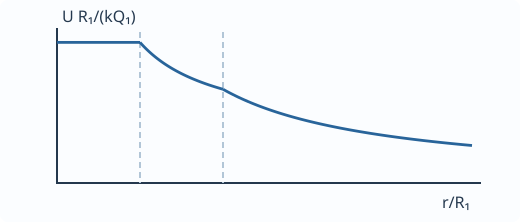

### 已知与求解

沿用 P39 习题 1.3-3 的同心球面。半径 $R_1<R_2$，电荷分别为 $Q_1,Q_2$。取无穷远为零电势，求三个区域的电势，画出分布曲线。

### 依据

两个球面的电势可代数叠加，单个球面内侧电势恒定。

### 推导

**第一步：写出单个均匀带电球面的电势。**

对半径为 $R$、总电荷量为 $Q$ 的均匀带电球面：

- 球面内 $r<R$，由高斯定理，电场强度为零，故电势为常量，并等于球面处电势：

$$
U_{\rm 内}=k\frac QR.
$$

- 球面外 $r>R$，电场与同量点电荷相同：

$$
U_{\rm 外}=k\frac Qr.
$$

**第二步：应用电势叠加原理。**

两个球面产生的电势直接代数相加。

**区域 I：球内，$0\le r<R_1$。**

观察点位于两个球面内部：

$$
\boxed{
U_{\mathrm I}(r)=
k\left(\frac{Q_1}{R_1}+\frac{Q_2}{R_2}\right)
}.
$$

**区域 II：两球面之间，$R_1<r<R_2$。**

观察点位于内球面外部、外球面内部：

$$
\boxed{
U_{\mathrm {II}}(r)=
k\left(\frac{Q_1}{r}+\frac{Q_2}{R_2}\right)
}.
$$

**区域 III：两个球面之外，$r>R_2$。**

观察点位于两个球面外部：

$$
\boxed{
U_{\mathrm {III}}(r)=
k\frac{Q_1+Q_2}{r}
}.
$$

因此总电势分布为

$$
\boxed{
U(r)=\frac{1}{4\pi\varepsilon_0}
\begin{cases}
\dfrac{Q_1}{R_1}+\dfrac{Q_2}{R_2},&0\le r<R_1,\\[6pt]
\dfrac{Q_1}{r}+\dfrac{Q_2}{R_2},&R_1\le r<R_2,\\[6pt]
\dfrac{Q_1+Q_2}{r},&r\ge R_2.
\end{cases}
}
$$

**第三步：检查边界连续性。**

在 $r=R_1$ 处：

$$
U_{\mathrm I}(R_1)=
k\left(\frac{Q_1}{R_1}+\frac{Q_2}{R_2}\right)
=U_{\mathrm {II}}(R_1).
$$

在 $r=R_2$ 处：

$$
U_{\mathrm {II}}(R_2)=
k\left(\frac{Q_1+Q_2}{R_2}\right)
=U_{\mathrm {III}}(R_2).
$$

故电势在两个球面处连续。

**第四步：讨论 $U-r$ 曲线。**

若 $Q_1>0、Q_2>0$，则：

- I 区：电势为常量，曲线为水平线；
- II 区：$U=k(Q_1/r+Q_2/R_2)$，随 $r$ 增大而下降；
- III 区：$U=k(Q_1+Q_2)/r$，继续下降并渐近于零；
- 在 $r=R_1、R_2$ 处曲线连续，但斜率一般发生变化。

若 $Q_1、Q_2$ 异号，分段表达式仍成立，但不能直接沿用“处处单调下降”的曲线形态，须结合电荷符号作图。

### 结果

$U(r)=k[Q_1/\max(r,R_1)+Q_2/\max(r,R_2)]$，在两球面处连续。

### 阅卷要点

在每区分别求两球面的电势贡献，检查 $R_1,R_2$ 处连续，并标注示意曲线采用的电荷符号。
