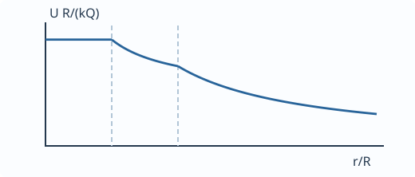

### 已知与求解

半径 $R$、带自由电荷 $Q$ 的金属球被均匀介质包覆至 $R'$，相对介电常量为 $\varepsilon$，再向外为真空。取无穷远为零电势，求各区的场强和电势以及金属球电势。

### 依据

高斯定理给出电位移，再由各区介电常量求电场。以无穷远为基准分段积分。

### 推导

以球心为原点，取半径为 $r$ 的同心球形高斯面。由球对称性，$\vec{D}$ 沿径向，且

$$
\oint_S\vec{D}\cdot\mathrm d\vec{S}=4\pi r^2D_r=Q.
$$

故在导体外部

$$
\boxed{\vec{D}(r)=\frac{Q}{4\pi r^3}\vec{r}}.
$$

**（1）介质层内、外的场强分布**

金属内部为静电平衡导体，场强为零。介质层内 $R<r<R'$：

$$
\boxed{\vec{E}_{\mathrm{in}}(r)
=\frac{Q}{4\pi\varepsilon_0\varepsilon r^3}\vec{r}
=\frac{Q}{4\pi\varepsilon_0\varepsilon r^2}\vec{e}_r}.
$$

介质层外 $r>R'$ 为空气（近似真空）：

$$
\boxed{\vec{E}_{\mathrm{out}}(r)
=\frac{Q}{4\pi\varepsilon_0r^3}\vec{r}
=\frac{Q}{4\pi\varepsilon_0r^2}\vec{e}_r}.
$$

导体内部 $r\le R$：$\vec{E}=0$。以上方向由 $Q$ 的正负决定。

**（2）介质层内、外的电势分布**

取 $V(\infty)=0$。介质层外：

$$
\boxed{V_{\mathrm{out}}(r)=\frac{Q}{4\pi\varepsilon_0r},\qquad r\ge R'.}
$$

对介质层内一点 $R<r<R'$，从该点到无穷远分段积分：

$$
\begin{aligned}
V(r)&=\int_r^{R'}\frac{Q}{4\pi\varepsilon_0\varepsilon s^2}\,\mathrm ds
+\int_{R'}^{\infty}\frac{Q}{4\pi\varepsilon_0s^2}\,\mathrm ds\\
&=\frac{Q}{4\pi\varepsilon_0\varepsilon}
\left(\frac1r-\frac1{R'}\right)
+\frac{Q}{4\pi\varepsilon_0R'}.
\end{aligned}
$$

整理得

$$
\boxed{V_{\mathrm{in}}(r)
=\frac{Q}{4\pi\varepsilon_0\varepsilon}
\left[\frac1r+\frac{\varepsilon-1}{R'}\right],\quad R<r<R'.}
$$

**（3）金属球的电势**

金属球为等势体，其电势等于介质内表面 $r=R$ 处的电势：

$$
\boxed{V_{\mathrm{metal}}
=\frac{Q}{4\pi\varepsilon_0\varepsilon}
\left[\frac1R+\frac{\varepsilon-1}{R'}\right]}.
$$

### 结果

介质层 $E_r=kQ/(\varepsilon r^2)$，外部 $E_r=kQ/r^2$。球电势 $U(R)=kQ[(1/R-1/R')/\varepsilon+1/R']$。

### 阅卷要点

用自由电荷求 $\vec{D}$，分区换算 $\vec{E}$，电势在 $R'$ 连续。
